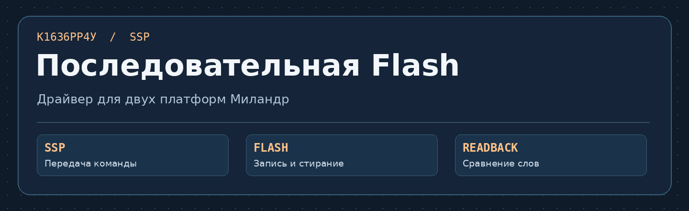

# Драйвер Flash К1636РР4У

Два примера на C для работы с последовательным интерфейсом **К1636РР4У** через аппаратный SSP микроконтроллеров Миландр. В каждом проекте драйвер работает с 16-разрядными данными и отдельно управляет линиями STROBE и BUSY.

## Проекты

| Вариант из статьи | Каталог | Цель и пакет в исходном Keil-проекте |
| --- | --- | --- |
| К1986ВЕ1Т | [examples/k1986ve1t](examples/k1986ve1t/) | `MDR1986BE1T`, `Keil.MDR1986BExx.2.2.0` |
| К1986ВЕ91Т | [examples/k1986ve91t](examples/k1986ve91t/) | `MDR32F9Q2I`, `Milandr.MDR32FxQI.1.3.2` |

Во втором архиве название платы в статье и выбранное устройство в Keil различаются. Сверьте целевое устройство, распиновку и настройки программирования с вашей платой перед прошивкой. Варианты драйвера лежат рядом с соответствующими проектами, поскольку используют разные выводы и заголовки SPL.

## Сборка в Keil

1. Установите **Keil µVision** с **Arm Compiler 5.06** и пакет устройства из таблицы.
2. В разделе «Файлы для скачивания» [статьи Миландр][article] скачайте архив выбранного варианта. Скопируйте его каталог `RTE/Device/` в соответствующий каталог примера, сохраняя вложенность. У архива К1986ВЕ91Т файлы находятся внутри каталога `RR4/`.
3. Откройте `RR4.uvprojx`. Через **Manage Run-Time Environment** проверьте компоненты Startup, PORT, RST_CLK, SSP, TIMER и EBC, перечисленные в проекте.
4. Подключите микросхему по схеме из статьи. В примере настройки тактирования рассчитаны на МК с рабочей частотой 80 МГц. Проверьте тактирование и только затем загрузите программу на стенд.

## Что проверяет пример

**Запуск `vTest_Ext_FLASH()` стирает первый блок внешней Flash.** Используйте тестовый экземпляр памяти. После стирания программа записывает чередующиеся `0x5555` и `0xAAAA` во второй подблок первого блока, считывает слова и считает несовпадения. Для просмотра локального `Num_errors` остановитесь в конце проверки и соберите пример без оптимизации.

| Операция | Функция |
| --- | --- |
| Чтение полуслова | `Read_Halfword_From_Flash()` |
| Запись полуслова | `Write_Halfword_To_Flash()` |
| Стирание блока | `Erase_Sector_Flash()` |

Автор статьи — **Илья Лампадов**. Исходные примеры и схемы опубликованы на портале Миландр. Пакеты устройств и файлы запуска подключаются локально. [Статья и архивы][article].

[article]: https://support.milandr.ru/base/spravka/mikroskhemy-pamyati/postoyannye-zapominayushchie-ustroystva/60515/
